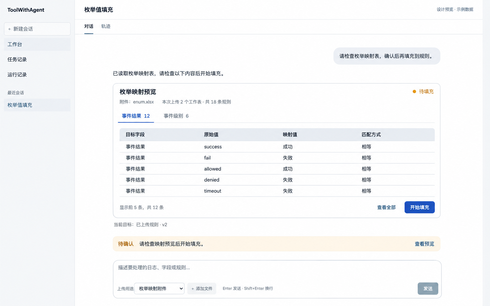
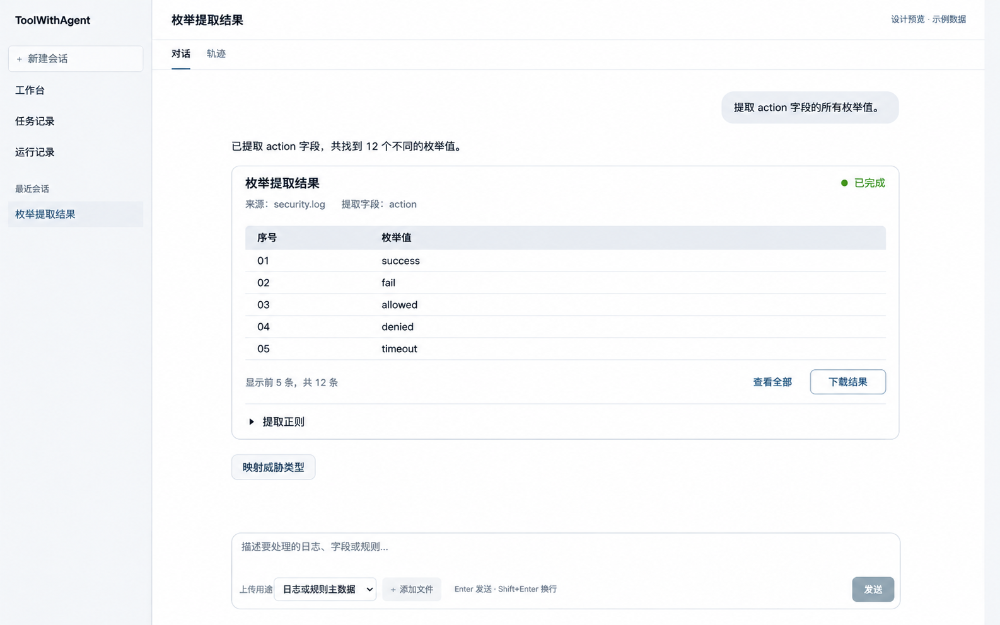

# V2 枚举表格展示设计提案

初稿：2026-11-12。归档更新：2026-11-13。状态：两张设计图已获用户确认，作为后续实施视觉基准；本次仅归档方案与设计图，不实施、不发布 tracker。

## 1. 需求与结论

在已确认的 V2 工作台视觉基础上，补充类似 Chainlit 的表格可读性，让用户看清“哪些原始值将映射到什么值”和“本次处理得到了什么”。可以实现，不需要嵌入 Chainlit，也不需要引入数据网格框架。

首期是只读展示，不包含枚举手工编辑、逐行勾选应用或新的业务流程。PRD §12 明确延后枚举手工编辑器；展示表格与编辑器是两个需求。

## 2. 已核实的现状

代码检查基准：主目录 master 为 ff6775d1；V2 功能以本地 GitHub 远端跟踪引用 `github/codex/v2-development` 的 d036eb52 为准，不能以主目录的早期 V2 骨架判断完成度。远端跟踪引用不等同于实时远端，后续实施前重新核对。

| 场景 | Chainlit | V2 已检查实现 |
|---|---|---|
| 上传枚举 Excel | `web/file_handlers.py` 展示生效 Sheet、目标字段、规则数、`enum_preview` 内联表格和开始填充按钮 | 明确的 `enum_mapping` 上传用途、文件校验与业务事实；对话上传卡没有同等枚举行表格 |
| 提取枚举 | `web/plan_renderer.py` 将 `artifact.values` 转成单列“枚举值”表格 | 对话显示结果卡和数量；查看产物后，`ArtifactValues` 用无序列表展示 values，并可展开正则 |
| 威胁类型映射 | 内联映射表格，可按门控下载 | 查看产物后已有“原始值 / 标准威胁类型 / 映射方式”三列表格；对话仍以通用结果卡为主 |
| 枚举填充 | 上传预览与实际填充是不同阶段，不能把预览当成已写入结果 | 已有 fill 操作，需从成功产物/执行事实判断写入，不可用附件总行数冒充实际填充数 |

关键文件：`web/parsers.py`、`web/file_handlers.py`、`web/plan_renderer.py`；V2 分支上的 `ConversationTimeline.tsx`、`App.tsx::businessCard`、`BusinessWorkspace.tsx::ArtifactValues/BusinessOperations`、`api.ts`、后端 `runtime/postprocessing.py` 和 `runtime/worker.py`。

## 3. 推荐界面

保留现有左右对齐消息、对话/轨迹页签、侧栏、输入区。表格置于助手消息正文下，使用完整助手内容宽度，不塞入用户气泡。结果详情仍按需打开，不新增常驻侧栏。

```text
枚举映射预览                                  待填充
附件：enum.xlsx    生效工作表：事件结果    规则：N 条
目标字段：事件结果
┌──────────┬──────────┬──────────┬──────────┐
│ 目标字段 │ 原始值   │ 映射值   │ 匹配方式 │
├──────────┼──────────┼──────────┼──────────┤
│ 事件结果 │ success  │ 成功     │ 相等     │
│ 事件结果 │ fail     │ 失败     │ 相等     │
└──────────┴──────────┴──────────┴──────────┘
显示前 5 条，共 N 条       [查看全部] [开始填充]
```

以上行仅为设计示例，不得注入真实结果。开始填充复用现有操作及配置选择；缺少可用配置时显示具体原因和上传规则引导，不允许点击后才静默选取来源。

三种表格结构：

- 上传预览：目标字段、原始值、映射值、匹配方式；多 Sheet 使用可滚动页签，页签标注完整条数。区分本次上传与累计生效 Sheet，保留后端现有附件合并语义。
- 枚举提取：序号、枚举值；字段名与完整去重值数放在标题下。正则是折叠的补充信息，不占表格主列。不虚构频次、占比或置信度。
- 映射结果：原始值、目标值、匹配方式；标题明确目标字段。复用威胁映射现有三列语义，避免另造一套表格。

对话默认展示前 5 行，较小结果全部展示；“查看全部”原位展开只读结果视图，保留导航和 Composer。建议每页 50 行，搜索作用于完整当前结果而非仅当前页；默认保留后端顺序，支持点击表头排序及恢复原序。返回时保留搜索、分页、会话位置和未发送草稿。此处数量与分页为新提案，不是现有实现事实。

填充成功后展示“已填充”摘要、准确目标配置/版本及查看结果入口。只有后端有精确写入事实时才展示逐行“已写入”；否则标明“来源映射预览”，并引导查看正式配置。重复填充的幂等成功展示“映射已存在，无新增”，不伪造新增数量。

## 4. 视觉与响应式

沿用最新工作台交接：侧栏 220px、标题 57px、页签 44px、消息最大宽 960px、根字号 15px；以实施基线真实 CSS 和已批准工作台截图再核验。不要恢复旧视觉文档的 320px 侧栏。

沿用 `styles.css` 的字体与 OKLCH Token：卡片 `--surface-card`、表头 `--surface-inset`、行线 `--border-subtle`、主文 `--foreground`、说明 `--muted-foreground`、操作 `--primary`。浅色参考分别为白、#F1F5F9、#E2E8F0、#0F172A、#475569、#3B82F6；实现必须引用变量，深色直接复用现有值，不重算 HEX。圆角 6px，普通表格无阴影。

正文左对齐；序号和计数用现有数字样式。建议表格字号 14px、单元格最小高 36px、水平内边距 12px；长值允许换行或展开全文，复制保留完整原值，不仅依靠 hover 提示。

窄屏保留核心列，在表格容器内横向滚动，不使整个页面横向溢出；按钮允许换行。表头有语义，排序有 `aria-sort`，按钮支持键盘和可见焦点。状态同时用文字和颜色表达。

## 5. 数据边界与异常

已有成功产物使用 artifact ID 和既有内容接口；历史卡绑定自己的版本，不能读取“当前最新”数据替换历史。附件预览绑定文件、校验 Run 和附件修订/快照，避免新附件覆盖旧消息。

当前公开 SessionFacts 主要提供枚举目标字段及计数，没有证据证明上传预览所需完整行已通过 UI API 暴露。因此：产物表格可以优先复用现有接口；上传预览可能需要最小的只读后端投影扩展，不能承诺纯前端即可完成全部需求。不得把整个 Session 或本机文件路径直接返回浏览器。

加载中显示占位；读取失败显示“结果读取失败，重试”；解析为空显示“未读取到有效映射规则”，禁用填充。权限失效清除数据；历史/过期结果允许按既有权限查看下载，但不可作为当前处理入口。业务失败不得出现伪成功表格，诊断残片不作为正式产物。

## 6. 范围与验收

首期：上传映射预览、枚举提取表格、映射结果一致化、完整查看与现有下载。下载使用既有正式产物类型和命名，不另造 Excel/CSV 下载承诺。

验收应覆盖：两主题、桌面与窄屏；0/1/5/超过 50 行；中文、空字符串、0、长值与特殊字符；多 Sheet 与累计附件；无配置、校验失败、取消、幂等填充；刷新恢复、历史结果不漂移、权限隔离；原有操作/下载/确认与草稿行为不回归。对话只显示业务信息，轨迹页继续隐藏整个输入区。

本提案未进行浏览器实测或实现测试，现状判断来自源码。下列两张静态设计图已获用户确认；完整展开、深色、窄屏和异常状态尚无已确认设计图，不将本次确认扩大为这些状态的视觉验收通过。

## 7. 用户确认的设计图（approved-v1）

用户确认原文：“OK 这两张图可以一起并入方案里，到时候可以一比一还原”。以下图片是确认时的原始 PNG，原样复制入库，禁止用后续截图覆盖。设计图由内置 imagegen 生成，是视觉基准，不是已实现页面或业务验收证据。

### 7.1 上传枚举映射表后的预览



固定视觉内容：助手消息下方完整宽度的只读结果卡；“枚举映射预览”标题与右侧“待填充”；附件和工作表统计；“事件结果 12 / 事件级别 6”页签；目标字段、原始值、映射值、匹配方式四列；前五行；右下角“查看全部 / 开始填充”；卡片下的目标规则说明；输入区上方的待确认提示。

此图的示例为本次上传两个工作表，共 18 条规则，当前“事件结果”页签共 12 条，预览 success、fail、allowed、denied、timeout 五行。这些数字只用于视觉对照，生产环境必须显示真实数据。图中“待确认”表示用户尚未发起填充，不得因此新建业务确认 token 或改变既有 Run 状态机。

### 7.2 枚举值提取完成后的结果



固定视觉内容：“枚举提取结果”标题与右侧“已完成”；来源 security.log、提取字段 action；窄序号列与宽枚举值列；01–05 五行；“查看全部 / 下载结果”；卡片内默认折叠的“提取正则”；卡片下的“映射威胁类型”操作；已完成状态不展示待确认提示条。

图中后续操作只代表布局位置。实际按钮是否显示、可用及使用哪个来源，仍由真实业务能力、字段血缘与权限决定，不因示例图强制开放。

## 8. 一比一还原与验收约定

1. 上述两张图是这两个浅色桌面状态的视觉验收基准。保持已确认的布局比例、消息对齐、卡片宽度、表格密度、页签位置、按钮层级、文字层级及留白，不重新设计。
2. 图片保留原始分辨率。实施前读取 PNG 尺寸并记录浏览器视口、DPR、字体与缩放；按参考图尺寸、DPR=1、缩放 100% 输出同尺寸截图。另在既有工作台 1440×900 视口核验布局；比较前只允许对整张参考图等比缩放，不能拉伸局部来掩盖差异。
3. 沿用真实工作台 CSS Token 和字体。图像生成造成的字形、抗锯齿或轻微色值差异不应转成新的硬编码颜色、阴影或字号；中文标签使用正文中的准确名称。不得为了贴图删除现有业务入口、权限提示或草稿保护。
4. 用隔离的固定示例数据复现两图，分别输出实现截图、叠加对照图和差异记录，逐项核对外壳、消息、结果卡、表格、操作区与 Composer。未解决的可见布局差异须列明，不能仅凭构建或测试通过宣称“一比一还原”。
5. 再用真实会话验证上传、开始填充、结果读取、查看全部、下载、历史版本和刷新恢复。固定数据视觉对照与真实业务证据分别标注；示例文件名、数量和行数据不能作为生产默认内容。
6. 两图以外的完整展开、深色、窄屏及异常状态按正文规则实现并另行截图检查；不得标记为本次已确认。后续经用户确认的视觉调整保存为新版本，并记录与 approved-v1 的差异。
