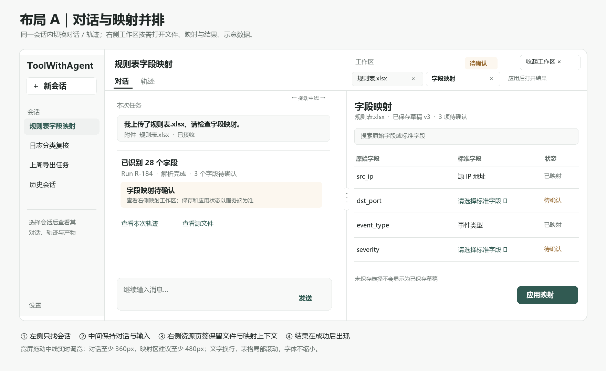
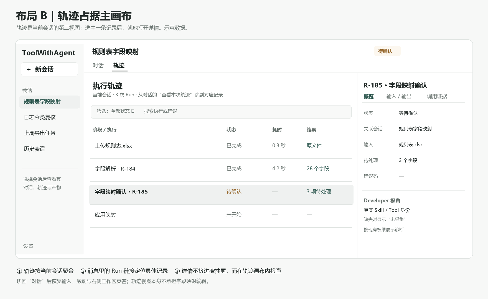
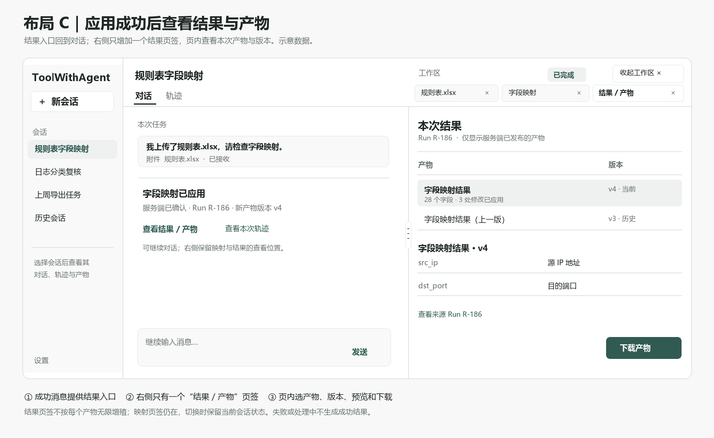
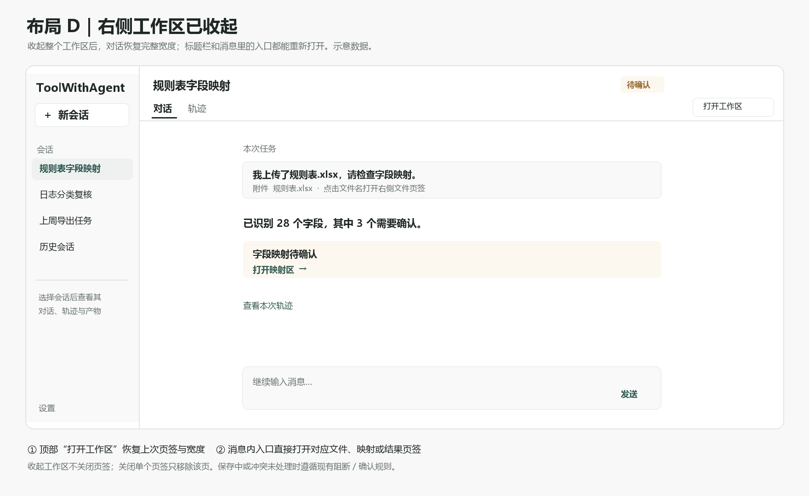

# V2 会话与右侧工作区布局决策

> 2026-10-30 已确认。记录用户根据 DeepSeek Harness 截图与源码提出的布局反馈，以及随后讨论的开合、伸缩和结果查看方式。本决策不代表前端已实施或真实业务验收通过。
> 产品目标与业务边界仍以 [前端体验重设计 PRD（Issue #427）](https://github.com/Jun-Wu05/ToolWithAgent/issues/427) 为准；已确认的静态视觉方向见[设计提交](https://github.com/Jun-Wu05/ToolWithAgent/blob/5055cf859fa04ee1082e243e5e579170434496a9/docs/design/v2-experience-static-direction.md)。精确色值尚未定稿。

## 布局

| 区域 | 职责 | 入口 |
|---|---|---|
| 左侧 | 选择、新建和找回会话；角色入口依现有权限显示 | 不把“运行记录”“产物”各设为普通用户的全局主导航项 |
| 中间 | 同一会话的“对话 / 轨迹”两个视图 | 默认对话；相关消息上的 Run 入口切到轨迹并定位记录 |
| 右侧 | 当前会话的文件、字段映射与结果查看工作区 | 从消息中的文件、映射或结果入口打开；顶部页签切换资源 |

“对话 / 轨迹”是会话视图切换；右侧“文件 / 字段映射 / 结果与产物”是资源页签，两层导航不混用。轨迹占据主画布，选中记录的详情在轨迹画布内查看。切到轨迹时暂时隐藏右侧工作区；切回对话后恢复此前打开的页签、宽度、对话输入和滚动位置。隐藏不等于关闭或丢弃草稿。

## 右侧页签与结果

- 点击输入消息的文件名，打开对应源文件页签；不同文件可以各有页签。字段映射页签在同一会话中只有一个实例，重新打开时复用服务端草稿与现有筛选、冲突、原子应用流程。
- 右侧只有一个“结果 / 产物”页签。页内列出当前会话中服务端已发布、当前身份有权查看的产物与版本；选中后预览、下载或回溯来源 Run。它不为每份产物不断新增顶层页签。
- 服务端确认应用成功并刷新后，相关对话消息出现真实结果入口；点击后打开“结果 / 产物”并定位新产物。处理中或失败时不显示虚构的成功结果。没有消息关联的旧数据标为“历史独立操作”，不补造对话消息。
- 现有接口提供会话详情中的产物和分页 Run 列表，没有全局产物列表接口。本轮按所属会话查看历史产物，不以跨会话搜索为验收目标。

## 打开、收起与伸缩

| 操作 | 预期行为 |
|---|---|
| 点右侧顶部“收起工作区” | 对话恢复完整宽度；本次页面保留当前会话的页签、选中项与工作区宽度 |
| 点对话标题栏“打开工作区” | 恢复上次页签和宽度；刷新页面后宽度恢复默认值 |
| 点消息中的文件名、“打开映射区”或“查看结果” | 打开工作区并激活对应页签；重复点击不创建重复的映射或结果页签 |
| 点某页签的 `×` | 只关闭该页；其他页签保留，仍可从对应消息入口重新打开 |
| 保存中或冲突确认未完成时关闭 | 遵守现有阻断或确认语义；不把未保存选择伪装为已保存草稿，重开后从服务端核对草稿版本 |

在 1440px 宽屏，右侧初始约占主内容 55%，用户可直接拖动中线实时调整；对话至少保留 360px 可读宽度。映射区 **480px 最小宽度是待实测的建议值**，须以真实字段、长文本和搜索选择器验证后定稿。内容随宽度换行，宽表在自身区域滚动，不缩小字号来容纳。分隔线须可键盘聚焦并用方向键调整；拖动中不卸载对话或映射组件。1024px 及更窄视口的映射工作区覆盖主内容，提供明确的“返回对话”。

## 视觉与证据边界

新方向沿用已确认静态稿的白色、浅灰、石墨文字和少量深青色主要操作；先前布局草图中的大面积绿色不代表目标配色。状态同时使用文字与语义色。下图中的文件名、字段、Run、产物和版本均为示意，不是实际接口或真实 Excel 验收证据。真实 Skill/Tool 身份只显示采集值，缺失显示“未采集”，Developer 诊断继续受权限控制。

| 状态 | 图 |
|---|---|
| 对话与映射并排，可拖动中线 |  |
| 轨迹与选中记录详情 |  |
| 应用成功后的结果与产物 |  |
| 右侧工作区收起后从对话重开 |  |

## 实施验收要点

1. 1440px 的同一会话完成上传、进展、映射、应用与真实结果闭环；对话和右侧映射可同时阅读，分隔线指针与键盘调整有效。
2. 从消息定位对应 Run；轨迹视图暂时隐藏右侧资源区，切回对话后输入、滚动、页签、草稿与宽度恢复。
3. 区分“收起整个工作区”和“关闭单个页签”；重复开合不复制映射实例、不丢服务端已保存草稿，保存中与冲突状态遵守阻断/确认语义。
4. 结果页签只显示有权限的真实产物、版本和下载入口；失败或未完成时不伪造成功。历史产物可通过所属会话找回。
5. 1024px 下覆盖式工作区可返回对话，无整页横向滚动；浅深主题、焦点与状态文字仍通过回归。

## 参考与待定

布局关系参考 DeepSeek Harness 的[会话视图切换](https://github.com/deepseek-ai/deepseek-harness/blob/ce7073d51254c26cd63b22a60835b8f948deb447/packages/client/ui-conversation/src/client/skeleton/ConversationSession.tsx)、[右侧资源页签](https://github.com/deepseek-ai/deepseek-harness/blob/ce7073d51254c26cd63b22a60835b8f948deb447/packages/client/ui-sidebar-right/README.md)和[可拖动三栏实现](https://github.com/deepseek-ai/deepseek-harness/blob/ce7073d51254c26cd63b22a60835b8f948deb447/packages/client/ui-layout/src/client/AppFrame.tsx)；本设计按 ToolWithAgent 的业务、权限与现有接口调整，不直接移植其视觉或代码。

待定：映射区最小宽度的实测值、浅深主题精确 Token、关闭最后一个资源页签后的面板行为、现有轻量执行详情如何迁入轨迹内详情。已同步 Issue #427 的 PRD、文档 PR #428 与视觉基线 PR #429；正式前端实施仍需完成这些待定细节和真实业务验收。
